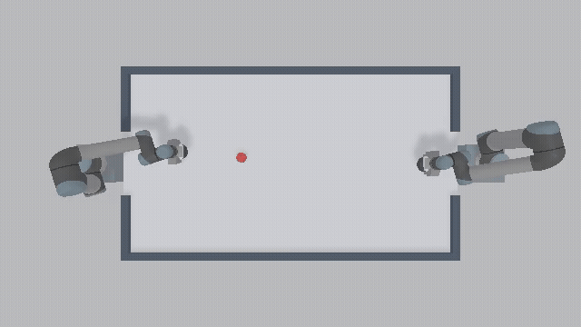

# BUAA-WAM · 气垫球联合世界模型实验

**用未来球轨迹监督当前状态表示，让机器人直接生成击球动作。**

基于 RoboTwin/SAPIEN 和双 UR5-WSG，验证 Fast-WAM 风格的联合训练能否改善气垫球控制。本分支包含模型、训练、仿真评测、测试、实验报告和一段演示；训练数据与模型权重不随代码上传。

## Demo



[观看原速 MP4](docs/demo/joint_policy_seed68.mp4) · GIF 为半速回放。

联合模型 seed42 在场景 seed68 的实际执行：左臂 0.290 秒接触，右臂 0.821 秒回击，继续记录至 1.821 秒。左臂从专家准备状态接管，右臂由专家控制。

## 实验设计

输入为过去 **0.4 秒的 9 帧 RGB**，以及当前机械臂的关节位置、速度和驱动目标差。冻结已训练的视觉定位前端，训练共享的当前状态编码器和三个输出分支。

```text
历史 RGB ── 固定视觉前端 ──┐
                          ├─ 当前状态编码器 C ─┬─ 动作策略 P
当前机械臂状态 ────────────┘                   ├─ 专家未来轨迹 F
                                              └─ 动作条件动力学 D
```

- **P：动作策略。** Flow Matching 生成接触延迟、目标 Y、期望球速、方向修正、速度倍率、控制提前量，现有 IK 与运动控制器负责执行。
- **F：未来辅助监督。** 从当前表示预测专家行为下的球轨迹，改善动作策略读取的表示。
- **D：动作条件预测。** 根据当前表示和已记录的执行指令，预测该动作后的球轨迹与击打接触。

F/D 预测决策后 **1 秒、间隔 0.05 秒**的球 XY。未来标签只参与损失，不输入策略；非专家动作和失败轨迹只训练 D，不作为策略模仿标签。首版学习轨迹而非未来视频，不是完整 Fast-WAM 视频模型复现。

## 运行流程

```text
专家回放到击球前准备状态
  → 读取 RGB 历史与当前关节状态
  → C 编码当前上下文
  → P 用 4 步采样生成一套击球意图
  → V4 来球预测为现有执行器提供接触参考
  → 几何、时序与 IK 检查
  → 左臂执行
  → 确认左臂物理接触后，右臂专家回击
  → 记录右臂接触后 1 秒并判定任务结果
```

策略本身不调用 F/D；现有执行桥接仍调用 V4 来球预测。当前是**专家准备状态中的一次接管**，右臂仍由专家控制，尚未实现从初始位姿自主双臂闭环控制。未接触、不可达和准备时间不足均保留为失败。

## 对照与结果

三组实验使用相同架构、数据和训练预算，各训练三个随机种子：

| 训练方式 | 动作监督 | 未来监督 | 未来损失更新 C |
| --- | --- | --- | --- |
| 纯动作 | 是 | 否 | 否 |
| 联合训练 | 是 | 是 | 是 |
| 停止未来梯度 | 是 | 是 | 否 |

同一组 15 个仿真场景的左臂真实接触结果：

| 训练随机种子 | 纯动作 | 联合训练 | 停止未来梯度 |
| --- | --- | --- | --- |
| 42 | 11/15 | 12/15 | 11/15 |
| 43 | 11/15 | 12/15 | 11/15 |
| 44 | 9/15 | 7/15 | 9/15 |

**总体持平，联合训练尚无稳定收益。** 第三个联合模型的八次失败均为准备时间不足。验证集选出的联合模型完成双臂 smoke test 2/3；当前默认 P2 模型保持不变。三个训练种子重复使用同一组场景，不是 45 个独立测试场景，也不是新场景泛化验证。

模型可训练参数 **444,557**，在 RTX 4070 Laptop 8 GB 上完成训练。联合 seed42 直接策略推理 p95 约 **3.65 ms**，含 V4 参考生成约 **5.29 ms**；不包含相机、完整 IK 或右臂搜索。[完整结果与实验边界](docs/joint_policy_j1_results.md)

## 代码结构

| 路径 | 作用 |
| --- | --- |
| `world_model/model.py` | RGB 定位、自由运动预测和历史视觉编码 |
| `world_model/joint_model.py` | 共享上下文、动作 Flow Matching、F/D 分支 |
| `world_model/joint_data.py` | 决策相对时间监督、接触掩码与数据划分 |
| `world_model/joint_inference.py` | 直接策略与现有执行器桥接 |
| `envs/_air_hockey/` | 场景、物理、快照、IK、专家控制和录制 |
| `scripts/*joint*.py` | 分支补采、联合训练与配对评测 |
| `scripts/validate_hit_pipeline.py` | 完整双臂流程验证 |
| `env_cfg/joint_air_hockey.yml` | 正式对照配置 |
| `tests/` | 信息隔离、梯度、接触、数据与仿真回归 |

## 环境与数据

Python 3.10；依赖版本见 [`scripts/requirements.txt`](scripts/requirements.txt)，主要使用 SAPIEN 3.0.0b1、PyTorch 2.4.1、NumPy 1.26.4。仿真录制需要可用的 NVIDIA/Vulkan 环境。

```bash
python -m pip install -r scripts/requirements.txt
python scripts/preview_air_hockey_assets.py
```

训练使用原生气垫球 HDF5：同步的 20 Hz RGB/状态、关节读数、`control/` 驱动目标、专家计划、相机标定和物理接触记录。历史目录名 `data/real_buaa_wam_hf/data` 中本实验使用的是**仿真数据**。原生 `action` 表示下一时刻实测状态，不能当作控制目标。

配置保留实验的历史运行路径。首次运行须先生成数据和前置 checkpoint，并更新对应 YAML 的 `data_root`、checkpoint 和分支目录；脚本会校验数据划分及 SHA256。[从采集到训练的准备步骤](docs/reproduce_joint_experiment.md)

## 训练与评测

准备好前置模型和分支数据后，在仓库根目录运行：

```bash
# 三种训练方式 × 三个训练随机种子
python scripts/train_joint_policy.py --config env_cfg/joint_air_hockey.yml --device cuda

# 将 <training_run> 替换为本次训练输出目录
python scripts/validate_joint_policy.py \
  --training-run <training_run> --split val --episodes 5
python scripts/validate_joint_policy.py \
  --training-run <training_run> --split test --episodes 15

# 完整双臂流程；模型先按验证集选择
python scripts/validate_hit_pipeline.py \
  --joint-checkpoint <training_run>/joint_seed42_best.pt \
  --episodes 3 --selection bc --device cuda
```

每次运行创建独立输出目录。模型和超参数只按验证集选择；真实接触与双臂任务成功分别统计。

## 测试

```bash
# 学习模块与数据契约；使用合成测试数据
PYTHONPATH=. python -m unittest tests.test_joint_model \
  tests.test_world_model_rgb tests.test_world_model_hit -v

# 完整回归，需要已配置的仿真/GPU环境
PYTHONPATH=. python -m unittest discover -s tests -v
```

实验阶段完整回归为 60 项：54 通过，6 条件跳过。GPU/viewer 条件跳过不代表相应功能已验证。

## 来源

基于 [RoboTwin](https://github.com/RoboTwin-Platform/RoboTwin)，沿用 [MIT License](LICENSE)。联合训练的信息隔离设计参考 [Fast-WAM](https://arxiv.org/abs/2603.16666)；本文结果来自本仓库的小模型气垫球实验。
